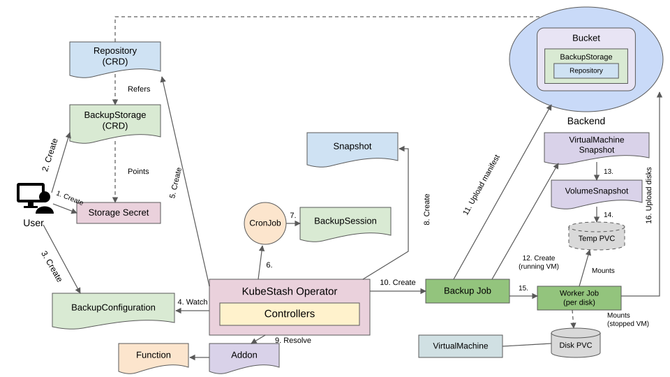
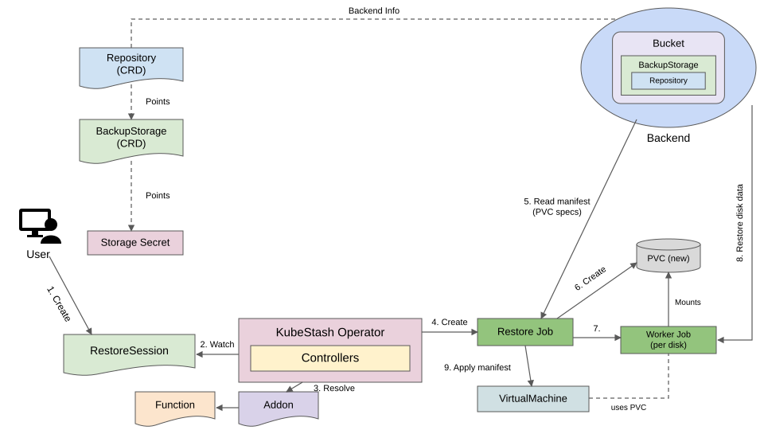
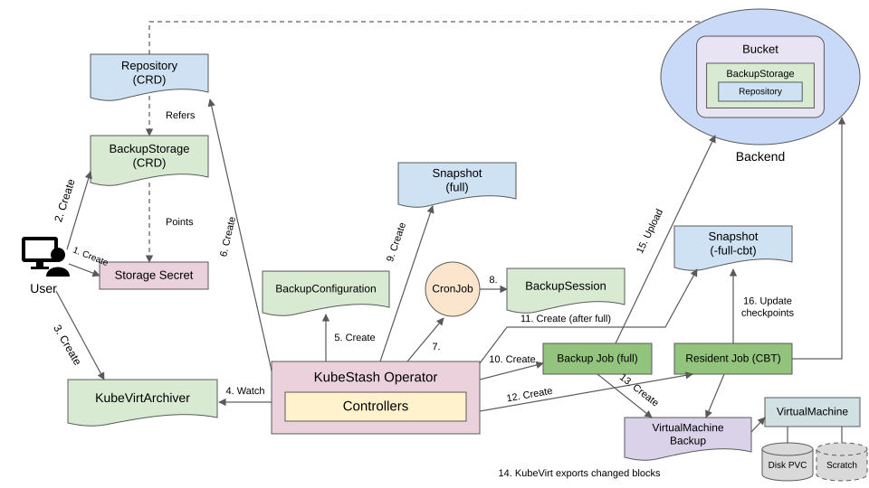
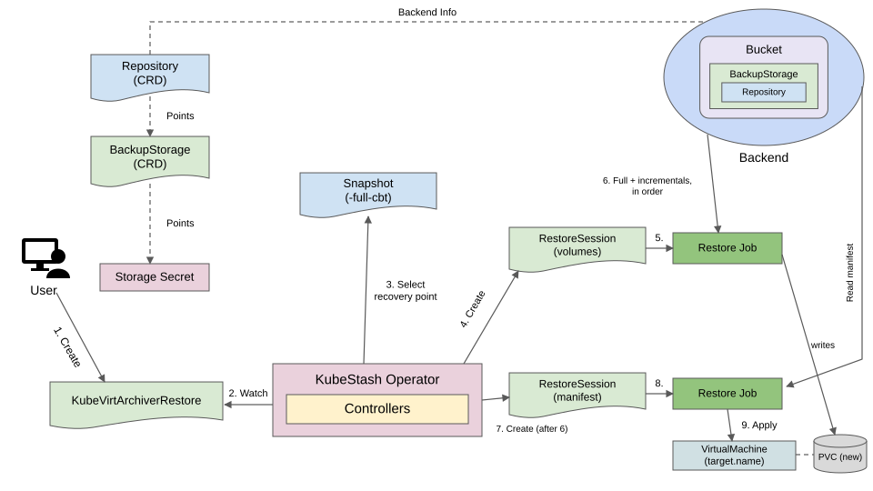

# KubeVirt VirtualMachine Backup Overview

KubeStash can back up a KubeVirt `VirtualMachine` (VM) in two ways:

- **Full backup**: a `BackupConfiguration` with the `kubevirt` addon. Each run stores the VM manifest and the whole content of every disk.
- **Archiver**: a `KubeVirtArchiver`. It takes a scheduled full backup and, in between, an incremental checkpoint every few minutes using KubeVirt changed block tracking (CBT). You can restore a VM to any of these checkpoints, or to a point in time.

This page shows how each of them works.

## Full Backup

### How Backup Works

The following diagram shows how KubeStash takes a full backup of a VM. Open the image in a new tab to see the enlarged version.

<figure align="center">
  
  <figcaption align="center">Fig: KubeVirt Full Backup Overview</figcaption>
</figure>

The backup process consists of the following steps:

1. At first, a user creates a `Secret` with the credentials of the backend where the backed up data will be stored.

2. Then, the user creates a `BackupStorage` that specifies the backend information and the `Secret`.

3. Then, the user creates a `BackupConfiguration` that targets the VM. It specifies the `Repository`, which points to the `BackupStorage`, and the `kubevirt` addon with the `logical-backup` task.

4. KubeStash operator watches for `BackupConfiguration` custom resources.

5. When it finds one, it creates the `Repository` specified in it.

6. Then, it creates a `CronJob` for each session with the schedule specified in the `BackupConfiguration`. It also triggers one backup right away.

7. On each scheduled slot, the `CronJob` creates a `BackupSession`.

8. KubeStash operator creates a `Snapshot` for the `BackupSession`.

9. Then, it resolves the `kubevirt` `Addon` and its `Function`.

10. Then, it creates the backup `Job`.

11. The `Job` first captures the VM manifest, along with the objects the VM depends on, and uploads it to the backend.

12. If the VM is running, the `Job` creates a `VirtualMachineSnapshot`, so the disks are captured without stopping the VM.

13. KubeVirt creates a CSI `VolumeSnapshot` of each disk.

14. The `Job` creates a temporary PVC from each `VolumeSnapshot`.

15. Then, it creates one worker `Job` per disk. The worker mounts the temporary PVC. If the VM is stopped, steps 12 to 14 are skipped and the worker mounts the VM's disk PVC directly.

16. Each worker uploads its disk to the backend and updates the `status.components[*]` field of the `Snapshot`. The temporary PVCs and the `VirtualMachineSnapshot` are deleted at the end.

### How Restore Works

The following diagram shows how KubeStash restores a VM from a full backup. Open the image in a new tab to see the enlarged version.

<figure align="center">
  
  <figcaption align="center">Fig: KubeVirt Full Restore Overview</figcaption>
</figure>

The restore process consists of the following steps:

1. At first, a user creates a `RestoreSession` that specifies the `Repository`, the `Snapshot` to restore, and the `kubevirt` addon task. With the `volume-restore` and `manifest-restore` tasks, the VM is restored under a new name; with the `logical-restore` task, it is restored under the original name.

2. KubeStash operator watches for `RestoreSession` custom resources.

3. When it finds one, it resolves the `kubevirt` `Addon` and its `Function`.

4. Then, it creates the restore `Job`.

5. The `Job` reads the backed up manifest to learn the PVC of each disk.

6. Then, it creates the destination PVCs, renamed for the new VM if a new name is given.

7. Then, it creates one worker `Job` per disk, which mounts the destination PVC.

8. Each worker writes the backed up disk data into its PVC.

9. Finally, the `Job` applies the VM manifest. The VM uses the restored PVCs, and comes back in the run state it had when it was backed up.

## Archiver

### How Backup Works

The following diagram shows how a `KubeVirtArchiver` backs up VMs continuously. Open the image in a new tab to see the enlarged version.

<figure align="center">
  
  <figcaption align="center">Fig: KubeVirt Archiver Backup Overview</figcaption>
</figure>

The backup process consists of the following steps:

1. At first, a user creates a `Secret` with the credentials of the backend.

2. Then, the user creates a `BackupStorage` that specifies the backend information and the `Secret`.

3. Then, the user creates a `KubeVirtArchiver`. It selects the VMs by namespace and label, and refers to the `BackupStorage`, the `RetentionPolicy` and the encryption `Secret`.

4. KubeStash operator watches for `KubeVirtArchiver` custom resources. For each matched VM, it checks that changed block tracking is enabled, and reports it in `status.virtualMachines`.

5. For each matched VM, it creates a `BackupConfiguration` for the scheduled full backup.

6. It creates the `Repository` for that VM.

7. It creates a `CronJob` with the full backup schedule. A full backup is also triggered right away.

8. On each scheduled slot, the `CronJob` creates a `BackupSession`.

9. KubeStash operator creates a `Snapshot` for the full backup.

10. Then, it creates the backup `Job` for the full backup.

11. When the full `Snapshot` has succeeded, the operator creates the incremental `Snapshot`, whose name ends with `-full-cbt`. It holds the chain of checkpoints that starts at this full backup.

12. Then, it creates the resident archiver `Job` for the VM. It keeps running and takes a checkpoint every `cbtBackup.interval`. It skips a checkpoint while a full backup is running.

13. For each checkpoint, the full backup `Job` and the resident `Job` create a KubeVirt `VirtualMachineBackup` in pull mode. The full backup asks for a full checkpoint; the resident `Job` asks for an incremental one.

14. KubeVirt exports the disks through a scratch PVC: all data for a full checkpoint, and only the blocks changed since the previous checkpoint for an incremental one.

15. The `Job` uploads the exported data to the backend, and then captures the VM manifest for the same checkpoint.

16. The resident `Job` records each completed checkpoint in the `status.components[*]` field of the `-full-cbt` `Snapshot`. A checkpoint is a recovery point once both its disks and its manifest are stored.

When the `RetentionPolicy` removes an old full `Snapshot`, the chain of checkpoints that starts at it is removed with it.

### How Restore Works

The following diagram shows how KubeStash restores a VM from an archiver. Open the image in a new tab to see the enlarged version.

<figure align="center">
  
  <figcaption align="center">Fig: KubeVirt Archiver Restore Overview</figcaption>
</figure>

The restore process consists of the following steps:

1. At first, a user creates a `KubeVirtArchiverRestore`. It specifies the `Repository` of the VM, the name of the new VM, and the recovery point: an exact `checkpoint` or a `targetTime`. Without a recovery point, the newest one is used.

2. KubeStash operator watches for `KubeVirtArchiverRestore` custom resources. It checks that the new VM does not exist yet.

3. It selects the recovery point from the `-full-cbt` `Snapshot`. With `targetTime`, it takes the newest recovery point that was complete at or before that time.

4. Then, it creates a `RestoreSession` for the disks.

5. KubeStash creates the restore `Job` for that `RestoreSession`.

6. The `Job` creates the PVCs of the new VM and writes the full checkpoint and then each incremental checkpoint of the chain, in order, up to the selected one.

7. When the disks are restored, the operator creates a second `RestoreSession` for the manifest.

8. KubeStash creates the restore `Job` for it.

9. The `Job` applies the VM manifest captured at the same checkpoint, under the new name. The new VM uses the restored PVCs.

## Temporary Volumes

A backup may create short-lived PVCs next to the VM. They do not hold the backup; the backup is stored in the backend.

| | Temp PVC | Scratch PVC |
|---|---|---|
| Used by | Full backup of a running VM | Archiver (full and incremental checkpoints) |
| Purpose | A copy of a disk made from its `VolumeSnapshot`, which the worker `Job` reads while the VM keeps running | Required by KubeVirt for a `VirtualMachineBackup`. In pull mode, which KubeStash uses, the data is streamed out and nothing reads it back |
| Size | Same as the VM disk | `spec.cbtBackup.scratchSize`, `2Gi` by default |
| StorageClass | Same as the VM disk | `spec.cbtBackup.scratchStorageClass`, or the cluster default |
| How many | One per disk, per backup | One per VM, per checkpoint |
| Deleted | When the backup finishes | When the checkpoint finishes |

A full backup of a stopped VM and a restore create neither of them.

## Next Steps

- Learn how to take a full backup of a VM and restore it from [here](/docs/guides/kubevirt/full-backup/index.md).
- Learn how to back up a VM continuously with a `KubeVirtArchiver` and restore it to a point in time from [here](/docs/guides/kubevirt/archiver/index.md).
